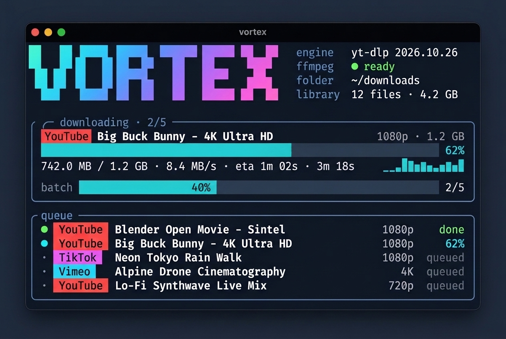

# Vortex — High-Speed Terminal Media Downloader

Paste a link, pick your quality, and pull media straight to your disk. Clean, colorful terminal interface with real-time speed sparklines and support for 1,800+ sites.

<p align="center">
  
</p>

<details>
<summary>ASCII preview (for terminals without images)</summary>

```
┌─────────────────────────────────────────────────────────────────────────────┐
│ ██╗   ██╗ ██████╗ ██████╗ ████████╗███████╗██╗  ██╗   engine  yt-dlp        │
│ ██║   ██║██╔═══██╗██╔══██╗╚══██╔══╝██╔════╝╚██╗██╔╝   ffmpeg  ● ready       │
│ ██║   ██║██║   ██║██████╔╝   ██║   █████╗   ╚███╔╝    folder  downloads     │
│ ╚██╗ ██╔╝██║   ██║██╔══██╗   ██║   ██╔══╝   ██╔██╗    library 12 files      │
│  ╚████╔╝ ╚██████╔╝██║  ██║   ██║   ███████╗██╔╝ ██╗                         │
│   ╚═══╝   ╚═════╝ ╚═╝  ╚═╝   ╚═╝   ╚══════╝╚═╝  ╚═╝                         │
│                                                                             │
│  tip   paste several links in a row to build a queue                        │
└─────────────────────────────────────────────────────────────── vortex v2.0 ─┘
```
</details>

## Quick Install

Clone or download this repository, then run the installer:

- **Windows:** Double-click **`install.bat`** (installs Python packages and sets up FFmpeg automatically via winget).
- **Linux / macOS:** Run `chmod +x install.sh && ./install.sh`

Or install manually:
```bash
pip install -r requirements.txt
```
*(Make sure `ffmpeg` is installed and available on your PATH for audio/video merging and MP3 conversion).*

## Start it

Double-click **`vortex.cmd`** (or `run.cmd`), or run from terminal:

```bash
python app.py
```

Then:

```
[1] Download       one link, several links, or a playlist
[2] From a file    batch from a .txt list

[3] History        review past downloads
[4] Settings       folder, quality, cookies, limits
[o] Open folder    explorer at the download directory

[5] Update engine  refresh yt-dlp extractors
[h] Help           supported sites and shortcuts
[q] Quit
```

Menus are single-key — press `1` and it goes, no Enter needed. Text prompts
(folder, proxy, filename) still need Enter. `Ctrl-C` leaves at any point.

## What it downloads

YouTube (incl. playlists), TikTok, Instagram, X/Twitter, Facebook, Reddit,
Vimeo, Twitch, SoundCloud, Dailymotion, Pinterest, Snapchat, LinkedIn,
Threads, Bluesky, Bilibili, Rumble, Kick, Odysee, Streamable, Imgur, Tumblr,
VK, Archive.org and roughly 1,800 other sites that yt-dlp knows.

## Picking quality

For a single link the menu is built from that video's real resolutions, with
frame rate and a rough file size so you can choose before committing:

```
[1] Best available    up to 2160p  ·  ████████████  ~1.3 GB
[2] 2160p             60 fps  ·  ███████████░  ~1.2 GB  ·  WEBM
[3] 1440p             60 fps  ·  ██████░░░░░░  ~612.0 MB  ·  WEBM
[4] 1080p             60 fps  ·  ██░░░░░░░░░░  ~184.0 MB  ·  MP4  ·  ★
[5] 720p              30 fps  ·  ░░░░░░░░░░░░  ~64.0 MB  ·  MP4
[6] Audio only · MP3  192 kbps
[7] Audio only · M4A  best quality, smallest audio
```

MP4/M4A tracks are preferred, so you normally get a `.mp4`. If the video only
exists as VP9/AV1/Opus, you get `.mkv` or `.webm` instead — same quality,
different container.

Batches ask for one quality up front and apply it to everything. If the exact
file already sits in the download folder, Vortex shows `kept` instead of
fetching it again — delete or rename the file to force a fresh copy.

## The screen

While bytes are moving you get one card for the current file — live bar,
transferred/total, speed, ETA, a small speed graph and elapsed time. Batches
add a queue underneath with a dot per item and a second bar for the whole run:

```
┌─ downloading · 2/5 ──────────────────────────────────────────┐
│  Big Buck Bunny                                              │
│   YouTube  ·  1080p  ·  1.2 GB                               │
│                                                              │
│  ██████████████░░░░░░░░░░░░░░░░░░░░░░░░░░░░░░░░░   62%      │
│  742.0 MB / 1.2 GB  ·  8.4 MB/s  ·  eta 1m 02s  ·  3m 18s    │
│                                                              │
│  batch  ██████████░░░░░░░░░░░░░░░░░░░░░░░░░░░░░░      2/5    │
└──────────────────────────────────────────────────────────────┘
```

The results card puts the title on one line and the saved filename underneath,
with a site chip, size, average speed and total time. `kept` means the exact
file was already on disk, so nothing was fetched again.

## Private or login-only posts

Instagram, TikTok, Facebook and age-restricted YouTube often need your
session. In **Settings → Cookies from browser** pick the browser you're logged
in with (Chrome, Edge, Firefox, Brave, Opera, Vivaldi, Safari). Close that
browser first if the cookie database is locked.

Cookies stay local; nothing is uploaded anywhere.

## Command line

```
python app.py URL                          best quality, menu-free
python app.py URL1 URL2 -q 720             batch at 720p
python app.py URL -a                       audio only, MP3
python app.py URL -i                       print metadata, download nothing
python app.py URL -o ~/videos              different folder
python app.py URL --cookies chrome         use Chrome's session
python app.py URL --no-thumbnail --no-metadata
python app.py --version
```

Exit code is `0` when every job succeeds, `1` otherwise — handy in scripts.

## Files

| File | Role |
|---|---|
| `app.py` | menus, queue, settings, history, CLI |
| `core.py` | yt-dlp wrapper: probe, format choice, download hooks |
| `ui.py` | panels, progress bars, tables |
| `config.py` | defaults, paths, history log |
| `config.json` | created the first time you change a setting |
| `history.json` | created after the first download (last 500 entries) |
| `downloads/` | default output folder |
| `vortex.cmd` / `run.cmd` | double-click launcher (Windows) |

## When something breaks

**"ffmpeg MISSING" in the banner** — merging and MP3 conversion need ffmpeg.
Install it and reopen the terminal so PATH refreshes.

**A site suddenly fails** — extractors break whenever a site changes. Use
**Update engine**, or `pip install -U yt-dlp`.

**"Sign in to confirm you're not a bot" / 403 / age-restricted** — set
cookies from your browser, or pass `--cookies chrome`.

**DRM-protected services** (Netflix, Disney+, Prime Video, Spotify) are not
supported and never will be here. That's a legal wall, not a bug.

**Nothing appears in `downloads/`** — check the results card: a red `failed`
row prints the reason under the title.

## Fair use

Download only what you have the right to keep. Respect each site's terms and
the creator's copyright — this is a personal archiving tool, not a reupload
pipeline.
